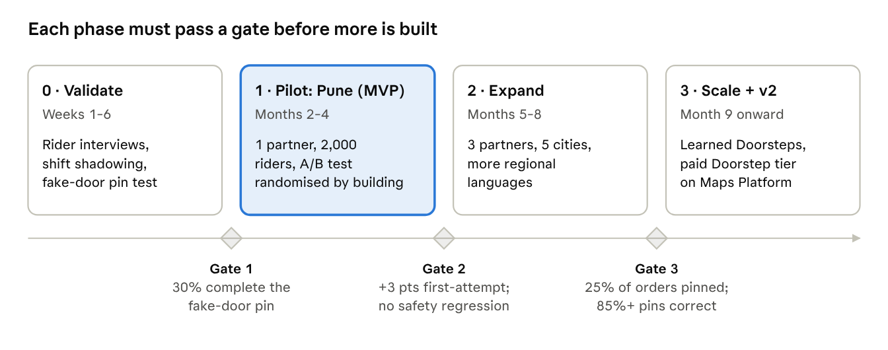

# Google Maps for India's Last Mile — Product Case Study

**Pawan Rathod** · November 2026 · Companion project: [DeliveryRadar](https://github.com/Rathore-Sahab/delivery-radar)

## TL;DR

In India, the hardest part of a delivery is often the last 100 metres, not the road. Addresses are written as landmarks ("behind Hanuman temple, 2nd gate"), so riders phone customers, circle blocks and sometimes give up.

**Proposal: Google Maps Doorstep.** It has two sides:

- **Customers** drop a precise *Doorstep Pin* (entrance, gate, floor note, optional photo) once and share it with any delivery app.
- **Riders** get an *Arrival Mode* that switches on within ~200 m and guides them to the right gate, not just the right building.

**North-star metric:** first-attempt delivery success on Doorstep-enabled addresses.

**Why Google:** Maps already has the base map, two-wheeler navigation, Plus Codes and the Maps Platform APIs that delivery apps build on. No single delivery company can build a shared, cross-app address layer.

## Problem & opportunity

A navigation app gets a rider to the street. In Indian cities, the delivery fails in the last 100 m.

**Why it breaks**

- **Unstructured addresses.** Many addresses are written as landmarks, and the same building can have several spellings. Geocoding drops the pin at a lane or locality centroid, not at the door.
- **Gated societies and complexes.** The pin lands on the right building but the wrong gate. Riders may need a specific tower, a security desk or a service entrance.
- **The phone call is the real navigation system.** Riders call customers to ask "where exactly?" The call costs the rider time and interrupts the customer, and it fails when the customer is busy or doesn't answer.
- **Every app re-solves the same address.** A food app, a quick-commerce app and a courier each learn the same doorstep separately. That knowledge is never shared.

**What I saw at Flipkart.** In the Issue Resolution Team at Flipkart FSC Pune, I tracked missing, damaged and orphan shipments. My hypothesis from that work: many escalations start as an address or handover problem rather than a transport problem. The rider interviews below are designed to test this.

**Data from my own project.** In [DeliveryRadar](https://github.com/Rathore-Sahab/delivery-radar) (96k real e-commerce orders), late orders averaged **2.3★ vs 4.3★** for on-time orders, and **61%** of late orders got a 1–2★ review. A broken delivery promise does disproportionate damage to customer trust.

**Size of the opportunity (approximate).** NITI Aayog estimated about 7.7 million gig workers in India in 2020–21, projected to reach about 23.5 million by 2029–30. A large share of them do delivery work. Every quick-commerce, food and parcel order ends at a doorstep, and the doorstep is where it fails.

## Users & insights

The delivery rider is the primary user. The customer creates the data, and the platform pays for failure.

| User | Who | Job to be done | Pain today |
| --- | --- | --- | --- |
| **Rider** (primary) | Gig rider on a two-wheeler in Pune. Many drops a day, paid per order. | "Get me to the right door fast, without calling anyone." | Pin at the wrong gate; repeated calls; unpaid minutes searching; phone use while riding |
| **Customer** (data creator) | Lives in a gated society with 6 towers and 2 gates | "Let my parcel find me without three phone calls." | Retyping landmarks in every app; calls during meetings; missed deliveries |
| **Platform / hub lead** (buyer) | Ops team at a food, quick-commerce or parcel company. My Flipkart role sat here. | "Cut failed attempts and 'where is my order' escalations." | RTO costs, reattempts, low ratings, orphan shipments |

**Insights to validate in rider interviews:**

1. Riders trust their own memory and the customer's voice more than the map pin once they are near the building.
2. Most time is lost *after* arriving in the area, not on the road.
3. A photo of the entrance is worth more than a written landmark.
4. Riders can't safely look at a screen while moving, so arrival guidance must be glanceable or voice-first.

## Why Google Maps should win this

Only a neutral, cross-app platform can build a shared doorstep layer. Google Maps is that platform in India.

- **Assets already in place.** The base map, two-wheeler navigation, Plus Codes, Street View and Maps Platform APIs (Geocoding, Routes, Places) are already used by delivery apps.
- **Network effect competitors can't copy.** A doorstep learned by one app benefits every app. A single delivery company only ever sees its own orders.
- **Two revenue paths.** Consumer: more daily use of Maps by riders and customers. Enterprise: a premium "Doorstep" tier on Maps Platform for delivery companies.
- **Fits Google's mission.** It organises a type of information that is currently scattered across phone calls and riders' memories.

**What Google should *not* do:** build its own delivery network or rider app. The value is in the layer, not in competing with partners.

## Solution: Google Maps Doorstep

Doorstep turns the last 100 m from a phone call into a map feature. It has four parts.

1. **Doorstep Pin (customer).** In Maps, the customer long-presses their home and drags the pin to the exact entrance. They add the gate or tower, a floor note and an optional entrance photo. They do this once.
2. **Share once, use everywhere (platform API).** The customer gets a short Doorstep link or Plus Code. They paste it into any delivery app, or, with consent, apps fetch it through Maps Platform. The address text stays as it is; the pin becomes the source of truth.
3. **Arrival Mode (rider).** Within ~200 m of the drop, navigation switches to a building-level view. It shows the right gate, the entrance photo and the parking spot, with a voice cue ("Use Gate 2, Tower C on your left"). One tap calls the customer only if needed.
4. **Learned Doorsteps (the flywheel).** When partner apps report where successful handovers happened (aggregated and anonymised), Maps improves the pin for that building, even for customers who never set one.

**Design principles:** voice-first for riders (safety) · customer-controlled and deletable (privacy) · works on low-end Android and patchy 4G · regional language support from day one.

## MVP scope & prioritisation

The MVP ships Doorstep Pin and Arrival Mode with **one** delivery partner in **one** city (Pune). It proves the riders' time saving before any network effect is built.

RICE = Reach × Impact × Confidence ÷ Effort. These are my estimates for a 6-month horizon, and the inputs are assumptions. Reach units differ (customers vs riders), so the scores rank features roughly; they are not exact comparisons.

| Feature | Reach (riders or users, pilot) | Impact (0.25–3) | Confidence | Effort (person-months) | RICE | Decision |
| --- | --- | --- | --- | --- | --- | --- |
| Doorstep Pin + share link | 50,000 customers | 2 | 80% | 4 | 20,000 | **MVP** |
| Arrival Mode (photo + gate + voice cue) | 2,000 riders | 3 | 70% | 6 | 700 | **MVP** (core rider value) |
| Partner API to fetch pins | 1 partner | 3 | 60% | 3 | 0.6 | **MVP** (needed for the pilot, low reach by design) |
| Learned Doorsteps from handover data | 0 in MVP | 3 | 40% | 10 | n/a | **v2**, after data-sharing agreements |
| Multi-stop two-wheeler batching | 2,000 riders | 1 | 50% | 8 | 125 | **Later**: partners already optimise routes |

**Why reach isn't everything here.** The partner API scores lowest on RICE, but without it the pilot can't run. I score it, then override with judgement. That trade-off is the kind I'd expect to discuss with an engineering lead.

## Success metrics

The north-star metric is **first-attempt delivery success on Doorstep-enabled addresses**. It moves only if riders actually find the door, and both the platform and the customer feel the result.

| Type | Metric | Pilot target (hypothesis) |
| --- | --- | --- |
| North star | First-attempt delivery success, Doorstep vs control addresses | +3 to 5 pts |
| Input (rider) | Time from "arrived in area" to handover | −30% |
| Input (rider) | Rider-to-customer calls per delivery | −40% |
| Input (customer) | Share of pilot orders with a Doorstep Pin | 25% by month 3 |
| Input (quality) | Share of pins confirmed correct by riders (one-tap "pin was right") | ≥ 85% |
| Guardrail | Rider screen interactions while moving | No increase |
| Guardrail | Privacy complaints, pin deletions | Below an agreed threshold |
| Guardrail | Maps app battery and data use in Arrival Mode | No measurable regression |

**Why not "delivery time"?** Total delivery time mixes kitchen prep, traffic and dispatch. Arrival-to-handover time isolates the part Doorstep changes.

## Launch plan & experiment design

The launch runs in four phases. Each one must pass a measurable gate before more engineering is spent.

**Pilot experiment (Phase 1)**

- **Unit of randomisation: the building, not the rider.** The same rider delivers to treatment and control buildings, so rider skill cancels out. Randomising by rider would let riders carry what they learned into control drops.
- **Treatment:** Doorstep Pin plus Arrival Mode is available for the building. **Control:** today's experience.
- **Primary metric:** first-attempt success. **Secondary:** arrival-to-handover time and calls per delivery.
- **Duration:** at least 4 weeks, covering both weekday and weekend patterns. Sample size to be set with the data science team for a 3-point minimum detectable effect.
- **Decision rule:** go to Phase 2 only if the north star improves *and* no guardrail regresses.

## Risks, trade-offs & open questions

The biggest risk is not technical. It is whether customers bother to set a pin and whether partners agree to share handover data.

| Risk | Why it matters | Mitigation |
| --- | --- | --- |
| Low customer adoption of pins | No pins means no Arrival Mode value | Prompt at the moment of pain: after a delivery with a call, ask "Save your doorstep so this doesn't happen again?" |
| Partners won't share handover data | Blocks Learned Doorsteps (v2) | Offer a free API tier in exchange for anonymised handover points; partners get better pins back |
| Privacy: a home entrance photo is sensitive | Trust and regulatory risk (India's DPDP Act) | Customer-owned, deletable, shared only per order and with consent; photos show the entrance, never the interior |
| Rider safety | A new screen could distract riders | Voice-first cues; Arrival Mode activates only below walking speed |
| Wrong pins | A bad pin is worse than none | Rider one-tap feedback; a pin with low confidence falls back to the normal geocode |

**Trade-off I'd make:** launch with customer-set pins only (slower to scale, high trust) before learned pins (fast to scale, privacy-heavy). Trust is hard to win back in a new market.

**Open questions**

- Will partners share the pin with Google, or treat it as their own data?
- Should housing societies be able to set official gate pins for all residents?
- How should Doorstep work for orders on behalf of someone else (gifts, elderly parents)?

## Appendix: assumptions & how I'd validate them

Every number above is a hypothesis. This is how I'd test each one cheaply before asking for engineering time.

| Assumption | Cheapest test | Signal that it's true |
| --- | --- | --- |
| Most rider time is lost after reaching the area | Interview 5–10 Pune riders; shadow 2 shifts and time each drop | Over a third of drop time is spent after arriving in the area |
| Customers will set a pin once | Fake-door test: a "Save your exact doorstep" card in a Google Form shared with 100 people | Over 30% complete it |
| An entrance photo beats a text landmark | Show riders the same address both ways; time them to the gate | Clear time saving with the photo |
| Partners value fewer failed attempts | Ask 2–3 hub or ops leads what a failed attempt costs | They can name a cost per reattempt and would trial it |

**Sources:** NITI Aayog, *India's Booming Gig and Platform Economy* (2022), for gig workforce estimates · Google Maps Platform documentation · DeliveryRadar analysis of the Olist public dataset (my own project).

---
*Independent case study by Pawan Rathod. Not affiliated with or endorsed by Google.*
